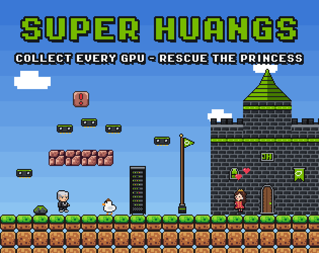
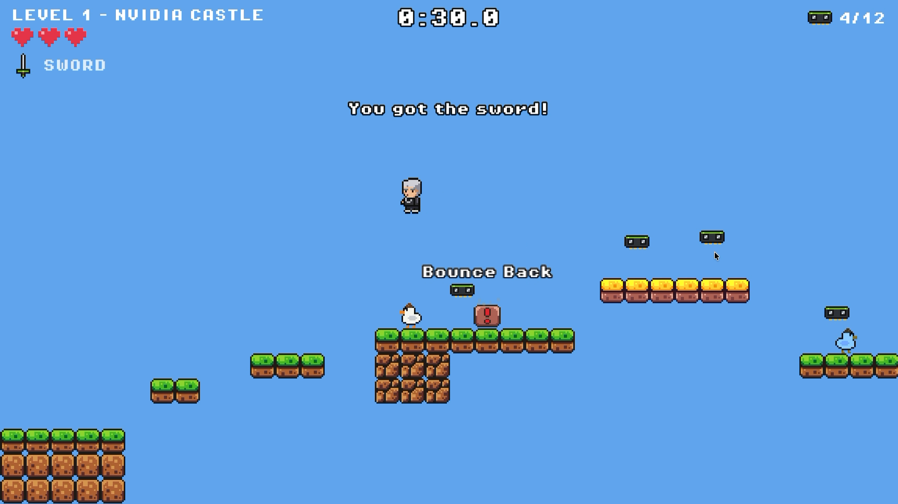
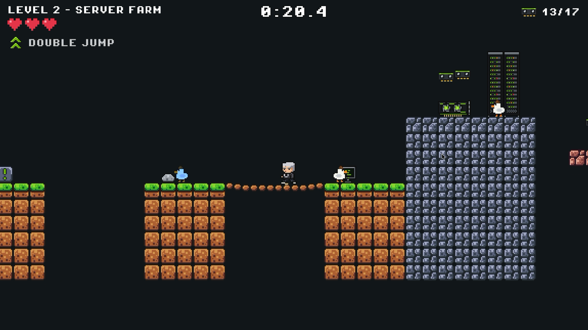
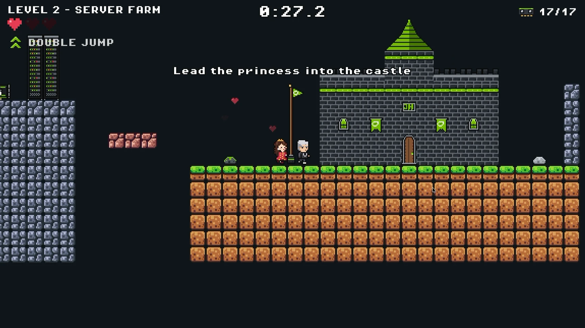
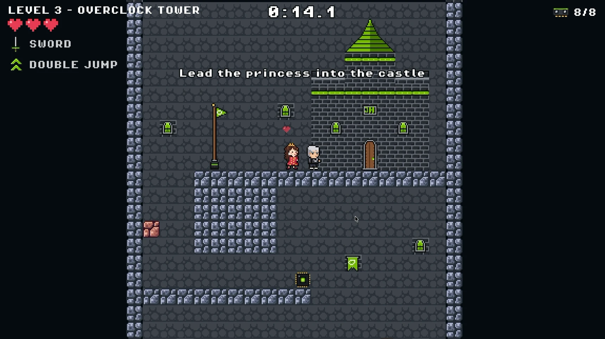

<div align="center">



# Super Huangs

**Collect every GPU to Rescue the princess.**

[](https://godotengine.org)
[](https://docs.godotengine.org/en/stable/tutorials/scripting/gdscript/index.html)
[](#)
[](https://fourtysevencode.itch.io/super-huangs)


</div>

---


## A super mario inspired platformer where you play as Jason Huang, Founding CEO of NEVADA from 1993-2026. Your objective is to save your princess from the evil Donald Duck who's blonde. Bounce (Jump) on the exclamation boxes (!) to receive a power up (sword / double jump) and get bounced back to spawn in order to progress. Reach the Nevada castle to save your princess! Collect RTX 5090s on the way as you do so! (in this economy?!)

## About the game

- **6 levels**, from an easy blue-sky intro to *The Cloud*, a huge climb to a castle in the sky
- **Power-ups** — grab the sword and the double jump from **!** boxes (they bounce you back to the start!)
- **Enemies**
  - **Brown ducks** patrol back and forth
  - **Jumping ducks** hop while they patrol
  - **Guard ducks** block the way and can only be beaten with the sword
  - **Scalpers** steal your GPUs — stomp them or hit them with the sword to get them back (3 hits)
- **3-star ratings** per level: finish it, finish with no deaths, and beat the target time
- **Saved progress** — best times and stars are saved in your browser
- **Live timer** and a dramatic *faaaah* every time you get hurt
- **Juice** — squash & stretch, dust puffs, screen shake, hit-stop and GPU sparkles
- **Cyberpunk skies** with parallax neon skylines in the later levels
- **Fullscreen** that keeps the same view, just bigger

## Screenshots

<table>
  <tr>
    <td></td>
    <td></td>
  </tr>
  <tr>
    <td align="center"><sub>Level 1 – Nvidia Castle</sub></td>
    <td align="center"><sub>Level 2 – Server Farm</sub></td>
  </tr>
  <tr>
    <td></td>
    <td></td>
  </tr>
  <tr>
    <td align="center"><sub>Level 2 – Leading the princess home</sub></td>
    <td align="center"><sub>Level 3 – Overclock Tower</sub></td>
  </tr>
</table>

## Levels

| # | Level | Target time |
|---|-------|---------------|
| 1 | Nvidia Castle | 1:00 |
| 2 | Server Farm | 1:15 |
| 3 | Overclock Tower | 1:30 |
| 4 | Neon Rooftops | 2:00 |
| 5 | Mainframe Core | 2:30 |
| 6 | The Cloud | 4:00 |

## Controls

| Key | Action |
|-----|--------|
| `A` / `D` | Move |
| `Space` | Jump |
| `Space` in the air | Double jump *(once you have it)* |
| `Left click` | Swing the sword *(once you have it)* |
| `R` | Restart the level |
| `F` | Toggle fullscreen |
| `Esc` | Back to the menu |

## Running it locally

1. Install [Godot 4.7](https://godotengine.org/download)
2. Clone the repo:
   ```bash
   git clone https://github.com/Stawberrymind/haven_game.git
